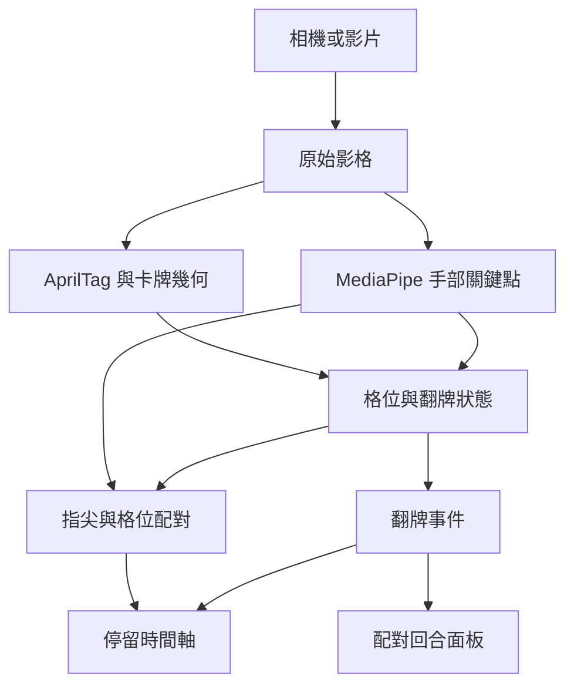

# 系統架構

這是單機、單相機的 Python 程式。攝影機模式由 OpenCV GUI 顯示。影片模式依序讀取畫面，預設寫出標註影片與點位 CSV。

## 模組

| 檔案 | 責任與入口 |
|---|---|
| `hand_tracking.py` | `main()` 解析 CLI，載入模型、派送影格、輸出 CSV 與影片。`LiveCapture` 使用背景執行緒和單格佇列，優先處理最近影格。`PreviewWindow` 在主執行緒處理按鍵及關窗。 |
| `card_locator.py` | `CardLocator.locate(frame)` 解碼 `tag36h11`，將參考 Tag 幾何映射為牌框。另有獨立影像、影片及相機 CLI。 |
| `board_tracker.py` | `detect_white_board()` 自動找開局白背格位。也可手動校正。`BoardTracker.update()` 更新每格觀測及穩定牌面，輸出翻牌事件。 |
| `session_timeline.py` | `EventTimeline.update()` 將手腕短期關聯、指尖停留與翻牌事件寫成時間軸，也繪製除錯面板。 |
| `memory_game.py` | `MemoryGame.update()` 用翻牌事件更新配對規則。`GamePanel` 顯示進度、回合紀錄與牌面縮圖，按狀態版本快取右側面板。 |

## 核心演算法

1. **牌框。** OpenCV ArUco 以預定義 `DICT_APRILTAG_36h11` 解碼，保留標記角點方向。每張牌的參考角點和兩個 Tag ID 定義於 `CARDS`。兩個標記用 homography 聯合擬合，重投影門檻為 `max(2 px, 0.15 × 標記邊長中位數)`。單一標記用四點透視估算。重複 ID 會排除該牌的姿態，無效或非凸四邊形也會捨棄。
2. **開局格位。** 對明亮、低飽和區域做形態學處理，過濾符合面積、長寬比和對比的四邊形，再依兩排整齊程度評分。模稜兩可的配置會拒絕。預設從上排左到右，再下排左到右。即時模式以至少三次穩定偵測鎖定格位，影片自動模式使用首幀。
3. **翻牌。** 牌中心落在唯一格位且同格 Tag 沒有衝突時，觀測為 `up`。無正面證據、手未遮住且白背亮度與周圍對比通過時，觀測為 `down`。其餘為 `unknown`。同一候選狀態連續三幀才更新穩定狀態。第一次看到正面但之前無穩定 `down` 時輸出 `front_seen`。
4. **指尖。** MediaPipe Tasks 以 VIDEO 模式處理同一幀的 RGB 影像。食指尖是關鍵點 8，轉到原影格像素後以 point-in-polygon 查詢。時間軸用手腕距離與 handedness 輔助關聯，預設停留 400 ms，容許短暫失去觀測最多 250 ms。記錄代表二維指尖位置與停留。
5. **回合。** 兩個不同、未配對的格位翻開才判定。水果類別由 `card_id` 字尾編號之前的字串取得。失配後等待翻開的牌蓋回。配對成功的格位不再計入。回合狀態目前在記憶體中，只在預覽啟用時運算。

相機要求 1920×1080，首次讀取失敗才會嘗試原生尺寸。若驅動在取圖呼叫內阻塞，主執行緒等待約八秒後報錯。欄位、時間起點及輸出範圍見 [DATA_FORMAT](DATA_FORMAT.md)。
